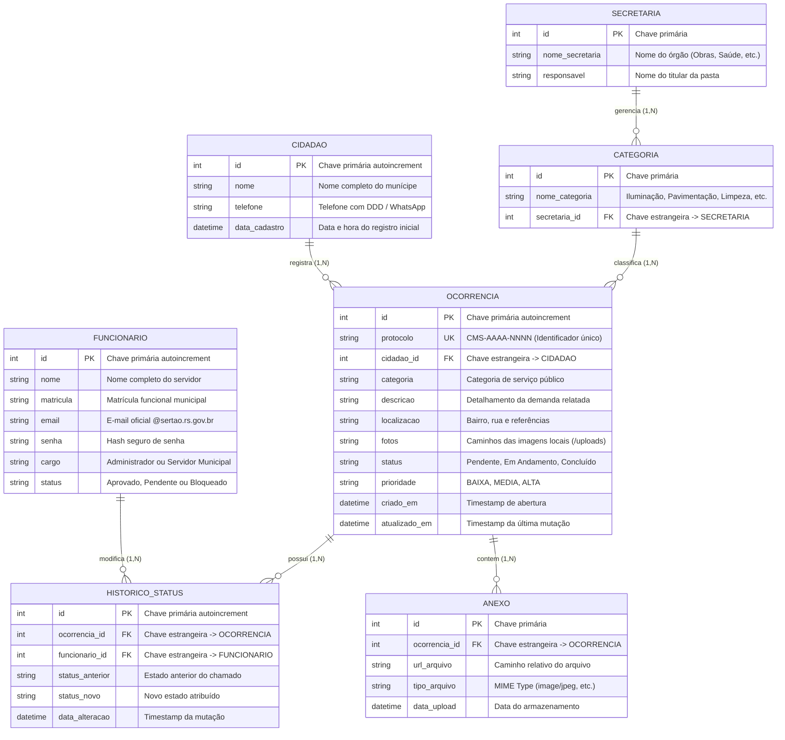

# Documentação Técnica do Projeto de Software — ComunicaSertão

**Instituto Federal de Educação, Ciência e Tecnologia do Rio Grande do Sul (IFRS) — Campus Sertão**  
**Curso Superior de Tecnologia em Análise e Desenvolvimento de Sistemas (ADS)**  
**Componente Curricular:** Projeto Integrador Extensionista I e II  
**Autor:** Fabricio Cardoso de Abreu (`2023022227@aluno.sertao.ifrs.edu.br`)  
**Orientadora:** Prof.ª Me. Caroline Guterres Silva  
**Repositório Oficial:** [https://github.com/2023022227-if/ComunicaSertao](https://github.com/2023022227-if/ComunicaSertao)  

---

## Sumário
1. [Visão Geral do Produto de Software](#1-visão-geral-do-produto-de-software)
2. [Regras de Negócio e Restrições do Sistema (Tópico 2)](#2-regras-de-negócio-e-restrições-do-sistema)
3. [Especificação de Requisitos do Sistema](#3-especificação-de-requisitos-do-sistema)
4. [Modelagem de Dados e Diagrama Entidade-Relacionamento (Tópico 4)](#4-modelagem-de-dados-e-diagrama-entidade-relacionamento)
5. [Arquitetura Técnica, Tecnologias e Infraestrutura (Tópico 5)](#5-arquitetura-técnica-tecnologias-e-infraestrutura)

---

## 1. Visão Geral do Produto de Software

O **ComunicaSertão** é uma plataforma integrada de gestão pública e zeladoria urbana/rural concebida sob medida para a Prefeitura Municipal de Sertão - RS. O sistema visa aproximar a administração pública dos cidadãos através de um canal conversacional acessível via WhatsApp integrado a um barramento de retaguarda (API RESTful) e a um painel de controle operacional.

A camada de **Back-End** atua como o núcleo transacional da solução, sendo responsável por processar os webhooks da Meta WhatsApp Cloud API, conduzir a máquina de estados do atendimento automatizado, emitir números de protocolos oficiais auditáveis, persistir ocorrências e evidências fotográficas em banco relacional estruturado e fornecer endpoints seguros consumidos pelo painel gestor.

---

## 2. Regras de Negócio e Restrições do Sistema

As regras de negócio (RNs) e restrições estabelecem as diretrizes operacionais, restrições lógicas e conformidades que delimitam o comportamento do software.

### 2.1 Regras de Negócio (RNs)

* **RN01 — Estrutura e Unicidade do Número de Protocolo:**
  Toda ocorrência registrada no sistema (seja via WhatsApp ou abertura manual pelo painel) deve receber obrigatoriamente um identificador alfanumérico único no padrão:
  $$\text{CMS-AAAA-NNNN}$$
  Onde `CMS` representa a sigla do sistema (ComunicaSertão), `AAAA` indica o ano corrente da solicitação (ex.: 2026) e `NNNN` representa um sequencial numérico indexado formatado em quatro dígitos (ex.: `CMS-2026-0001`, `CMS-2026-0002`). Uma vez gerado, o protocolo torna-se imutável e atua como chave pública de consulta do cidadão.

* **RN02 — Ciclo de Vida e Transições de Status das Ocorrências:**
  O ciclo de vida de uma demanda obedece a uma máquina de estados estrita:
  1. **`Pendente`:** Estado inicial atribuído automaticamente no momento da criação do chamado.
  2. **`Em Andamento`:** Transição efetuada quando um servidor municipal assume a triagem, agenda vistoria ou despacha a ordem de serviço ao setor de obras/iluminação.
  3. **`Concluído`:** Transição executada quando o serviço foi finalizado e homologado pela secretaria responsável.
  4. **`Cancelado`:** Atribuído quando a demanda for considerada improcedente, duplicada ou apresentar dados inverídicos. Toda mutação de status deve registrar atomicamente o identificador do servidor, data/hora e justificativa na tabela de histórico.

* **RN03 — Classificação de Prioridades e Triagem por Categoria:**
  Cada ocorrência deve ser vinculada a uma categoria oficial pré-cadastrada (ex.: Iluminação Pública, Pavimentação/Vias, Limpeza Urbana, Saneamento/Esgoto, Poda de Árvores). O sistema calcula a prioridade operacional (`BAIXA`, `MEDIA`, `ALTA`) com base no risco público e impacto logístico relatado.

* **RN04 — Restrição de Domínio de E-mail Institucional:**
  O acesso ao painel administrativo e às rotas de gerenciamento é estritamente restrito a funcionários da prefeitura. O back-end valida obrigatoriamente se o e-mail submetido possui o sufixo oficial `@sertao.rs.gov.br`. Cadastros com domínios públicos genéricos (como `@gmail.com`, `@hotmail.com`) são rejeitados com código HTTP 400.

* **RN05 — Homologação Hierárquica de Novos Servidores:**
  Para garantir a segurança da informação e a proteção de dados dos cidadãos, qualquer solicitação de acesso submetida na tela de cadastro entra no banco de dados com status **`Pendente`**. 
  - Enquanto estiver pendente, tentativas de login resultam no bloqueio com código **HTTP 403 (Forbidden)**.
  - O acesso só é liberado após a aprovação expressa por um usuário com privilégio de **`Administrador`** (perfis homologados: Fabricio de Abreu, Patrick Telo e Gestão Central da Prefeitura).
  - Administradores possuem autoridade exclusiva para alterar cargos, aprovar ou bloquear temporariamente credenciais.

* **RN06 — Política de Mídias e Evidências Fotográficas:**
  O envio de fotos pelo cidadão via WhatsApp ou painel passa por validação estrita de MIME type. São aceitos apenas arquivos nos formatos `.jpg`, `.jpeg`, `.png` e `.webp`. O back-end renomeia o arquivo utilizando padrão seguro com hash UUID (`foto_xxxxxxxxxx.ext`), prevenindo ataques de sobrescrita (*path traversal*) e servindo a imagem através de diretório protegido (`/uploads`).

---

### 2.2 Restrições do Sistema

* **RES01 — Restrição Tecnológica de Retaguarda:** O back-end deve ser integralmente desenvolvido em **Python 3.10+**, utilizando o framework assíncrono **FastAPI** e executado sobre o servidor ASGI **Uvicorn**, aproveitando concorrência nativa por meio de rotinas não bloqueantes (`async/await`).
* **RES02 — Restrição de Banco de Dados Local (Soberania de Dados):** Os dados devem ser persistidos localmente no banco relacional embutido **SQLite** (`comunicasertao.db`), gerenciado via **SQLAlchemy ORM**. Não é permitida a dependência de serviços externos pagos de SGBD em nuvem, garantindo soberania e facilidade de backup institucional.
* **RES03 — Conformidade com a LGPD (Lei nº 13.709/2018):** Dados de contato dos munícipes (número de telefone e nome) devem ser utilizados exclusivamente para o tratamento da demanda e emissão de avisos de status, ficando restritos a servidores autenticados.
* **RES04 — Restrição de Licenciamento e Custo Zero:** O software deve ser baseado 100% em tecnologias de código aberto (Open Source), sem impor mensalidades ou dependência de plataformas proprietárias SaaS (como Octadesk ou Zendesk).

---

## 3. Especificação de Requisitos do Sistema

### 3.1 Requisitos Funcionais (RFs)

| Identificador | Nome do Requisito | Descrição Técnica | Prioridade |
| :--- | :--- | :--- | :--- |
| **RF01** | Recepção de Webhooks | Fornecer endpoint HTTPS assíncrono (`/webhook/whatsapp`) para recepcionar mensagens e eventos da Meta Cloud API. | Alta |
| **RF02** | Máquina de Estados do Bot | Conduzir a sessão conversacional do cidadão em etapas lógicas (menu, categoria, relato, localização e foto). | Alta |
| **RF03** | Emissão de Protocolo | Calcular e atribuir código sequencial anual único (`CMS-AAAA-NNNN`) a cada nova ocorrência registrada. | Alta |
| **RF04** | Consulta por Protocolo | Permitir que o cidadão consulte o status do seu protocolo em tempo real diretamente pelo bot ou web. | Média |
| **RF05** | CRUD de Ocorrências | Prover rotas REST para listagem, filtros por status/categoria/bairro e mutações de chamados pelo painel. | Alta |
| **RF06** | Autenticação Institucional | Autenticar servidores municipais verificando hash de senha e domínio corporativo `@sertao.rs.gov.br`. | Alta |
| **RF07** | Workflow de Aprovação | Disponibilizar rotas (`PATCH /funcionarios/{id}/status`) para que Administradores aprovem ou bloqueiem acessos. | Alta |
| **RF08** | Upload Seguro de Fotos | Validar extensão, gerar nome UUID e armazenar evidências fotográficas em disco local (`/uploads`). | Média |
| **RF09** | Métricas e Estatísticas | Consolidar volumetria mensal, distribuição por categoria e prazos operacionais para apoio gerencial. | Média |

### 3.2 Requisitos Não Funcionais (RNFs)

| Identificador | Categoria | Descrição Técnica | Prioridade |
| :--- | :--- | :--- | :--- |
| **RNF01** | Desempenho e Latência | A API deve responder às requisições ordinárias em menos de 200 ms, sustentando concorrência assíncrona. | Alta |
| **RNF02** | Integridade Relacional (ACID) | O banco SQLite deve assegurar atomicidade, consistência, isolamento e durabilidade via SQLAlchemy ORM. | Alta |
| **RNF03** | Validação de Contratos | Todo tráfego de entrada e saída na API deve ser higienizado e validado via esquemas fortemente tipados do Pydantic. | Média |
| **RNF04** | Documentação Viva (OpenAPI) | A API deve expor a especificação OpenAPI 3.0 e interface gráfica Swagger UI acessível diretamente em `/docs`. | Média |
| **RNF05** | Segurança de Acesso | Bloqueio automático de tentativas de acesso de usuários com status "Pendente" com emissão de HTTP 403. | Alta |

---

## 4. Modelagem de Dados e Diagrama Entidade-Relacionamento

A persistência do ComunicaSertão foi estruturada através de modelagem relacional normalizada, implementada em arquivo SQLite local (`comunicasertao.db`) por meio de classes de modelo do **SQLAlchemy**.

### 4.1 Diagrama Entidade-Relacionamento (DER Lógico)



---

### 4.2 Dicionário de Dados Detalhado

#### Tabela 1: `funcionarios` (Controle de Acessos e Governança)
Armazena os servidores públicos municipais habilitados ou solicitantes de acesso ao painel de gestão.

| Atributo | Tipo de Dado | Restrições | Descrição Técnica |
| :--- | :--- | :--- | :--- |
| `id` | INTEGER | PK, Autoincrement | Identificador primário numérico do servidor. |
| `nome` | VARCHAR(120) | NOT NULL | Nome civil completo do funcionário municipal. |
| `matricula` | VARCHAR(30) | NULL | Número de matrícula institucional no município. |
| `email` | VARCHAR(120) | UNIQUE, NOT NULL | E-mail oficial terminado em `@sertao.rs.gov.br`. |
| `senha` | VARCHAR(255) | NOT NULL | Senha de autenticação com critérios de complexidade. |
| `cargo` | VARCHAR(50) | NOT NULL | Perfil de atuação: `Administrador` ou `Servidor Municipal`. |
| `status` | VARCHAR(20) | NOT NULL, DEFAULT 'Pendente' | Estado do acesso: `Aprovado`, `Pendente` ou `Bloqueado`. |

#### Tabela 2: `ocorrencias` (Núcleo Transacional de Chamados)
Contém os registros de demandas de zeladoria abertas pelos cidadãos via WhatsApp ou painel.

| Atributo | Tipo de Dado | Restrições | Descrição Técnica |
| :--- | :--- | :--- | :--- |
| `id` | INTEGER | PK, Autoincrement | Identificador interno sequencial. |
| `protocolo` | VARCHAR(30) | UNIQUE, NOT NULL, INDEX | Código público anual formatado (`CMS-2026-XXXX`). |
| `cidadao_nome`| VARCHAR(120) | NOT NULL | Nome do munícipe informante. |
| `cidadao_telefone`| VARCHAR(30) | NOT NULL | Número de WhatsApp com DDD. |
| `categoria` | VARCHAR(60) | NOT NULL | Categoria do chamado (Iluminação, Vias, Limpeza, etc.). |
| `descricao` | TEXT | NOT NULL | Relato detalhado do problema no município. |
| `localizacao` | VARCHAR(255) | NOT NULL | Endereço, bairro, estrada vicinal ou ponto de referência. |
| `fotos` | TEXT | NULL | Lista de caminhos locais de imagens no formato CSV. |
| `status` | VARCHAR(30) | NOT NULL, DEFAULT 'Pendente'| Situação: `Pendente`, `Em Andamento`, `Concluído`, `Cancelado`. |
| `prioridade` | VARCHAR(20) | NOT NULL, DEFAULT 'MEDIA' | Grau de urgência: `BAIXA`, `MEDIA` ou `ALTA`. |
| `criado_em` | DATETIME | NOT NULL, DEFAULT NOW | Data e hora exata da abertura do registro. |
| `atualizado_em`| DATETIME | NULL | Data e hora da última alteração de status. |

---

## 5. Arquitetura Técnica, Tecnologias e Infraestrutura

### 5.1 Arquitetura em Camadas (Layered Architecture)

A infraestrutura foi concebida seguindo o padrão arquitetural em camadas desacopladas:

```
[ Usuários: Cidadãos (WhatsApp) & Servidores (Painel Web) ]
                           │
                           ▼ Requisições HTTPS (JSON / Form-Data)
┌────────────────────────────────────────────────────────────────────────┐
│                   1. Camada de Exposição & Gateway                     │
│   • Servidor ASGI Uvicorn     • Roteamento FastAPI (app.main)          │
│   • Middleware CORS           • Documentação OpenAPI / Swagger UI      │
└───────────────────────────────────┬────────────────────────────────────┘
                                    │
                                    ▼ Validação de Schemas
┌────────────────────────────────────────────────────────────────────────┐
│                   2. Camada de Validação & Contratos                   │
│   • Pydantic Schemas (app.schemas)                                     │
│   • Higienização de Payloads, Tipagem Estática e Serialização          │
└───────────────────────────────────┬────────────────────────────────────┘
                                    │
                                    ▼ Invocação de Serviços
┌────────────────────────────────────────────────────────────────────────┐
│                   3. Camada de Lógica de Negócio                       │
│   • Bot Service & Máquina de Estados (app.bot_service)                 │
│   • Geração de Protocolos Sequenciais (CMS-2026-XXXX)                   │
│   • Módulo de Autenticação e Homologação de Acessos                    │
│   • Processador de Uploads e Armazenamento Estático de Mídias          │
└───────────────────────────────────┬────────────────────────────────────┘
                                    │
                                    ▼ Operações Mapeadas
┌────────────────────────────────────────────────────────────────────────┐
│                   4. Camada de Mapeamento Objeto-Relacional            │
│   • SQLAlchemy ORM (app.models & app.database)                         │
│   • Sessões Transacionais ACID (SessionLocal & Dependency Injection)   │
└───────────────────────────────────┬────────────────────────────────────┘
                                    │
                                    ▼ Leitura / Escrita
┌────────────────────────────────────────────────────────────────────────┐
│                   5. Camada de Persistência Relacional                 │
│   • Banco SQLite Local: comunicasertao.db                              │
│   • Diretório de Arquivos Estáticos: uploads/                          │
└────────────────────────────────────────────────────────────────────────┘
```

---

### 5.2 Catálogo de Endpoints RESTful Implementados

| Método | Rota / Endpoint | Função no Sistema | Permissão / Acesso |
| :---: | :--- | :--- | :--- |
| `GET` | `/` | Retorna status de saúde da API e rotas disponíveis. | Público |
| `GET` | `/docs` | Interface gráfica Swagger UI para testes da API. | Público |
| `POST` | `/auth/login` | Autentica servidor público e valida status de acesso. | Público (Servidores) |
| `GET` | `/funcionarios` | Retorna lista de servidores aprovados e pendentes. | Autenticado |
| `POST` | `/funcionarios` | Registra solicitação de novo acesso (entra como Pendente). | Público |
| `PATCH` | `/funcionarios/{id}/status` | Aprova, altera cargo ou bloqueia acesso de servidor. | **Administrador** |
| `DELETE` | `/funcionarios/{id}` | Remove solicitação ou credencial de servidor. | **Administrador** |
| `GET` | `/ocorrencias` | Lista ocorrências cadastradas com filtros de status. | Autenticado |
| `GET` | `/ocorrencias/{id_ou_protocolo}` | Retorna detalhes de um chamado por ID ou protocolo. | Público / Autenticado |
| `POST` | `/ocorrencias` | Abertura manual de demanda pelo painel da prefeitura. | Autenticado |
| `PATCH` | `/ocorrencias/{id}/status` | Altera status de atendimento do chamado (Kanban). | Autenticado |
| `PATCH` | `/ocorrencias/{id}/prioridade`| Altera o nível de prioridade (Baixa, Média, Alta). | Autenticado |
| `GET` | `/cidadaos` | Agrupa munícipes e histórico de chamados vinculados. | Autenticado |
| `GET` | `/estatisticas` | Consolida métricas, evolução mensal e distribuição. | Autenticado |
| `POST` | `/simulador/chat` | Ponto de teste conversacional do bot de WhatsApp. | Público |
| `POST` | `/webhook/whatsapp` | Ponto de entrada de webhooks da Meta Cloud API. | Meta API |
| `POST` | `/upload/foto` | Recebe arquivo de imagem, valida e retorna URL estática. | Público |

---

### 5.3 Estratégia de Implantação e Manutenção

1. **Execução Contínua em Segundo Plano:** O servidor pode ser inicializado através de daemons ASGI (`uvicorn app.main:app --host 0.0.0.0 --port 8000`) gerenciados por utilitários de processo como *Systemd* ou *PM2* em ambientes Linux, ou serviços nativos em ambiente Windows Server.
2. **Backups Automatizados do Banco de Dados:** A adoção do SQLite permite que rotinas diárias de backup sejam executadas sem necessidade de paralisar a aplicação: um simples script de cópia fria do arquivo `comunicasertao.db` e do diretório `uploads/` garante cópias íntegras e restauração imediata em caso de contingência.
3. **Escalabilidade Transparente:** Como o sistema utiliza SQLAlchemy ORM para isolar o dialeto SQL, caso o município venha a expandir substancialmente sua demanda e exija um cluster de banco em nuvem (ex.: PostgreSQL), basta reconfigurar a variável de ambiente `DATABASE_URL` sem demandar reescrita das regras de negócio.
